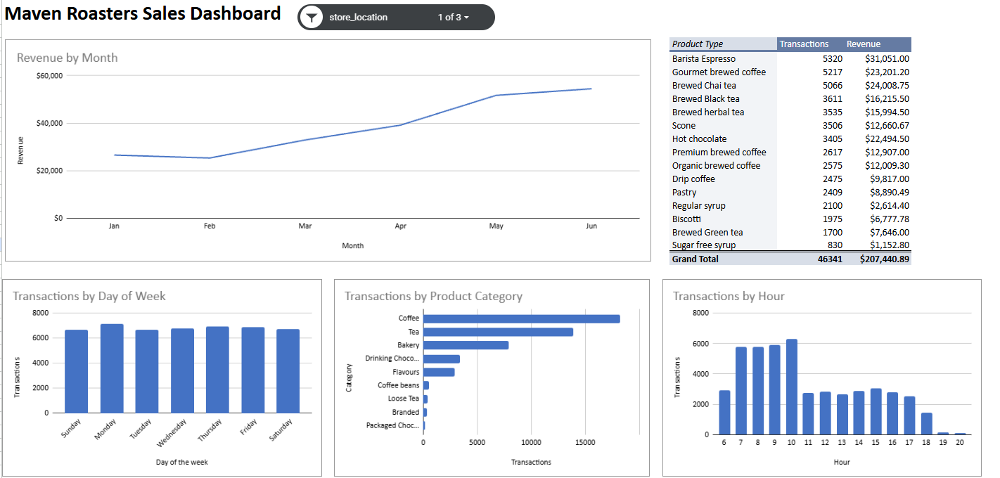

# Coffee Shop Sales Dashboard

Interactive sales dashboard for a fictional New York coffee chain (Maven Roasters),
built in Google Sheets.

**Live dashboard:** [View in Google Sheets](https://docs.google.com/spreadsheets/d/11Nm3ZPD3xAfO4NlW5UXHhk8TqdDmUlOxhzRYTKA7IaM/edit?pli=1&gid=1646017324#gid=1646017324)

## Data
- 149,116 transactions, Jan to Jun 2023, 3 stores
- Source: Maven Analytics Coffee Shop Sales dataset

## What I did
- Added revenue, month, weekday and hour columns using formulas
- Built pivot tables for revenue and transactions by month, day, hour, category and product
- Created a dashboard with charts, a Top 15 products table and a store slicer

## Key insights
- Revenue doubled from Jan to Jun ($81.7K to $166.5K)
- 7 to 10am drives 45% of transactions and revenue
- Coffee and tea make up about 67% of revenue
- All 3 stores perform almost equally (about $230K each)
- Average transaction is small, about $4.69

## Recommendations
1. Staff up for the 7 to 10am rush and run lighter shifts later in the day
2. Bundle pastries with drinks to raise the average order
3. Run afternoon promotions to lift quiet hours
4. Review evening opening hours, since after 6pm brings in under 10% of sales

## Tools
Google Sheets: formulas, pivot tables, charts, slicers
